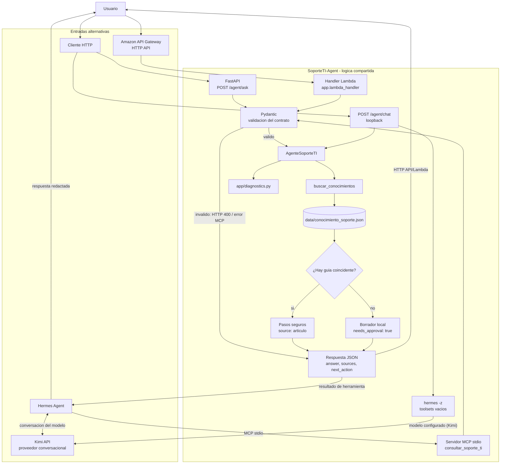

# Arquitectura y Mapa de Componentes

## Componentes y responsabilidades

| Capa | Componente | Responsabilidad | Tecnologia |
| --- | --- | --- | --- |
| Interfaz HTTP | `app/main.py` | Expone `GET /health`, `POST /agent/ask` y el chat local `POST /agent/chat`. | FastAPI |
| Chat Hermes | `app/hermes_bridge.py` | Envia el resultado del diagnostico local al Hermes CLI sin habilitar herramientas; Hermes usa su modelo configurado para redactar la respuesta. | Hermes CLI / WSL |
| Contrato HTTP | `AgentAskRequest`, `AgentAskResponse` | Valida solicitud y estructura de respuesta. | Pydantic |
| Adaptador Lambda | `app/lambda_handler.py` | Adapta eventos de API Gateway HTTP API al mismo contrato y agente. | AWS Lambda |
| Orquestacion compartida | `app/agent.py` (`AgenteSoporteTI`) | Coordina busqueda, preguntas de seguimiento, recomendaciones y escalacion. | Python |
| Busqueda y escalacion | `app/tools.py` | Carga conocimiento una vez, normaliza acentos y ordena varias coincidencias completas. | Python |
| Diagnostico | `app/diagnostics.py` | Produce hipotesis heuristicas e interpreta resultados de red declarados por el usuario; no ejecuta comprobaciones. | Python |
| Conocimiento | `data/conocimiento_soporte.json` | Contiene articulos, palabras clave y pasos de soporte. | JSON versionado |
| Adaptador MCP | `app/mcp_server.py` (`consultar_soporte_ti`) | Publica la misma logica para Hermes mediante stdio; valida el contrato HTTP. | MCP Python SDK |
| Orquestador conversacional | Hermes Agent | Presenta la conversacion y decide cuando invocar la herramienta MCP. | Hermes |
| Modelo conversacional | Kimi configurado en Hermes | Interpreta la conversacion y redacta la respuesta; no es parte del backend Python. | API Moonshot |
| Configuracion de Hermes | `~/.hermes/config.yaml` y entorno privado de Hermes | Registra el servidor MCP y mantiene la credencial del proveedor fuera del repositorio. | YAML y entorno local |
| Despliegue HTTP | `template.yaml` | Define API Gateway HTTP API y la funcion Lambda de SAM. | AWS SAM |
| Calidad | `tests/test_agent.py` | Verifica contratos, busqueda, escalacion, MCP y API. | Pytest |

## Mapa del flujo de solicitud

La API HTTP, el handler Lambda, el servidor MCP y el chat web reutilizan la
logica de `AgenteSoporteTI`. El chat web añade una segunda etapa de redaccion
con Hermes/Kimi, despues del diagnostico local. No habilita herramientas del
modelo. El servidor MCP sigue disponible para que Hermes lo invoque en sus
propias sesiones.

Para la configuracion reproducible, consulta la
[guia tecnica Hermes + Kimi](guia-tecnica-hermes-kimi.md) y, para el uso
cotidiano, la [guia para usuarios](guia-usuario-hermes-kimi.md).

## Ciclo cloud-native del agente

1. **Objetivo y contexto:** recibe `question`, `user_id` y `context` opcional.
2. **Validacion:** exige pregunta de 5 a 500 caracteres e identificador de usuario de 3 a 50 caracteres.
3. **Decision:** `buscar_conocimientos` normaliza acentos y puntuacion, compara palabras completas y ordena las guias por coincidencias.
4. **Diagnostico:** `app/diagnostics.py` formula hipotesis y preguntas; si el usuario declara resultados de red, los interpreta como no verificados.
5. **Respuesta conocida:** devuelve las guias, pasos, confianza heuristica y `recopilar_datos` si falta contexto.
6. **Escalacion:** cuando no hay articulo, crea un borrador solo en memoria y devuelve `needs_approval: true` y `borrador_pendiente_aprobacion`.
7. **Observabilidad del resultado:** HTTP expone JSON; MCP entrega los mismos campos como resultado de herramienta.
8. **Limites:** no se ejecutan comandos, no se cambia configuracion del equipo, no se modifica una contrasena y no se crea ni envia un ticket real.

## Modos de ejecucion

- **Local conversacional:** Hermes inicia `app.mcp_server` por stdio, utilizando el entorno Python configurado en Hermes. La credencial de Kimi reside en la configuracion privada de Hermes.
- **API HTTP:** FastAPI valida `POST /agent/ask` y responde con el contrato descrito en [api-contract.md](api-contract.md).
- **Chat web + Hermes/Kimi:** `POST /agent/chat` solo acepta loopback, calcula el diagnostico local y lanza `hermes -z` con las herramientas deshabilitadas; el historial vive en el navegador.
- **AWS SAM:** API Gateway HTTP API invoca `app.lambda_handler.handler`, que comparte los modelos Pydantic y el agente.

## Datos, seguridad y limites

- `data/conocimiento_soporte.json` se versiona junto con el codigo; los articulos no se descargan de una fuente externa durante la solicitud.
- El borrador de escalacion no se guarda ni se envia. `incident_id` permanece en `null`; un sistema de tickets requiere integracion, persistencia y aprobacion explicita.
- La API HTTP documentada no incluye autenticacion. Antes de exponerla en una red publica se deben anadir autenticacion, autorizacion, limites de uso y transporte seguro.
- El puente del chat web tambien es solo local: requiere Hermes accesible desde WSL y el modelo/cuota configurados. La pregunta, el resultado local y el historial de la conversacion se envian al proveedor del modelo a traves de Hermes; no se envia `user_id`.
- MCP stdio es local al entorno que ejecuta Hermes. No se debe exponer como servicio remoto sin autenticacion y transporte seguro.
- Las claves API no pertenecen a la base de conocimiento ni al repositorio. Kimi se configura en Hermes y `.env` se mantiene local.
- `POST /agent/ask` y el diagnostico base no consultan Kimi. En `POST /agent/chat`, Hermes/Kimi redactan la respuesta sobre el resultado local; esta ruta no delega al modelo la seleccion de fuentes ni habilita herramientas.

## Limites y trabajo futuro

La base de conocimiento y los borradores son locales y no persistentes. La
busqueda sigue siendo por palabras clave y no comprende semanticamente
sinonimos o intenciones. La confianza es heuristica y no calibrada. Para un uso
productivo faltan, segun el modo de despliegue, autenticacion, autorizacion,
persistencia/auditoria, RAG, integracion aprobada con tickets, herramientas
remotas autorizadas y un proceso de revision de articulos. Las recomendaciones
siguen siendo informativas y deben escalarse si no coinciden con el entorno
institucional.