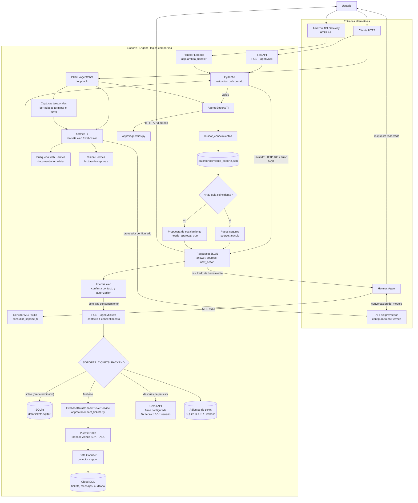

# Arquitectura y Mapa de Componentes

## Componentes y responsabilidades

| Capa | Componente | Responsabilidad | Tecnologia |
| --- | --- | --- | --- |
| Interfaz HTTP | `app/main.py` | Expone `GET /health`, `POST /agent/ask` y el chat local `POST /agent/chat`. | FastAPI |
| Chat Hermes | `app/hermes_bridge.py` | Envia pregunta, historial, diagnostico local y capturas temporales a Hermes; configura web y, si hay imagenes, vision. | Hermes CLI / WSL |
| Contrato HTTP | `AgentAskRequest`, `AgentAskResponse` | Valida solicitud y estructura de respuesta. | Pydantic |
| Adaptador Lambda | `app/lambda_handler.py` | Adapta eventos de API Gateway HTTP API al mismo contrato y agente. | AWS Lambda |
| Orquestacion compartida | `app/agent.py` (`AgenteSoporteTI`) | Coordina busqueda, preguntas de seguimiento, recomendaciones y escalacion. | Python |
| Busqueda y escalacion | `app/tools.py` | Carga conocimiento una vez, normaliza acentos y ordena varias coincidencias completas. | Python |
| Diagnostico | `app/diagnostics.py` | Produce hipotesis heuristicas e interpreta resultados de red declarados por el usuario; no ejecuta comprobaciones. | Python |
| Conocimiento | `data/conocimiento_soporte.json` | Contiene articulos, palabras clave y pasos de soporte. | JSON versionado |
| Adaptador MCP | `app/mcp_server.py` (`consultar_soporte_ti`) | Publica la misma logica para Hermes mediante stdio; valida el contrato HTTP. | MCP Python SDK |
| Orquestador conversacional | Hermes Agent | Presenta la conversacion y decide cuando invocar la herramienta MCP. | Hermes |
| Modelo conversacional | Proveedor configurado en Hermes (Kimi recomendado en esta instalacion) | Redacta la respuesta y puede consultar la web o analizar imagenes mediante las herramientas habilitadas; no es parte del backend Python. | API del proveedor seleccionado |
| Configuracion de Hermes | `~/.hermes/config.yaml` y entorno privado de Hermes | Registra el servidor MCP y mantiene la credencial del proveedor fuera del repositorio. | YAML y entorno local |
| Confirmacion de ticket | `POST /agent/tickets` y formulario web | Exige datos de contacto y consentimiento explicito antes de crear el ticket o notificar al tecnico. | FastAPI / navegador |
| Servicio de tickets | `app/tickets.py` | Persiste tickets y capturas en SQLite por defecto; envia el correo al tecnico con copia (`Cc`) al usuario despues de guardar. | SQLite / Gmail API |
| Backend Firebase | `app/dataconnect_tickets.py` | Implementa persistencia alternativa de tickets, mensajes y auditoria mediante las operaciones del conector. | Python |
| Puente Data Connect | `app/dataconnect_bridge.mjs` | Ejecuta operaciones permitidas con Firebase Admin SDK y Application Default Credentials (ADC); no acepta consultas arbitrarias del navegador. | Node.js |
| Servicio Data Connect | `dataconnect/` | Define esquema descargado, conector `support` y operaciones para crear, listar, consultar, resolver tickets y actualizar el estado del correo. | Firebase Data Connect |
| Base persistente | Cloud SQL `soporteit-tickets-database` | Almacena las tablas existentes de tickets, mensajes y eventos de auditoria. No se aplican migraciones desde la app. | Cloud SQL for PostgreSQL |
| Despliegue HTTP | `template.yaml` | Define API Gateway HTTP API y la funcion Lambda de SAM. | AWS SAM |
| Calidad | `tests/test_agent.py` | Verifica contratos, busqueda, escalacion, MCP y API. | Pytest |
| Calidad de tickets | `tests/test_tickets.py`, `tests/test_dataconnect_tickets.py` | Verifica persistencia SQLite/Data Connect, idempotencia, escalacion con consentimiento, correo y seguimiento. | Pytest |

## Mapa del flujo de solicitud

La API HTTP, el handler Lambda, el servidor MCP y el chat web reutilizan la
logica de `AgenteSoporteTI`. El chat calcula primero el diagnostico local y
despues invoca Hermes con la herramienta web; cuando hay capturas tambien
habilita vision. No se habilitan terminal ni ejecucion de comandos. Las
capturas temporales se eliminan al terminar el turno. Si el diagnostico no
encuentra guia suficiente, el chat formula seguimiento y ofrece escalar tras
tres respuestas del usuario (cuarto mensaje contando la consulta inicial); se puede pedir
contactar al tecnico antes. El ticket y el aviso no se generan hasta que el
usuario proporciona contacto y autoriza compartir el caso. Las imagenes se
guardan en el ticket tras el consentimiento, se muestran en el panel local y
no se adjuntan al correo. El servidor MCP sigue disponible para que Hermes lo
invoque en sus propias sesiones.

## Persistencia y notificaciones de tickets

`SOPORTE_TICKETS_BACKEND` selecciona `sqlite` (predeterminado) o `firebase`.
Con Firebase, la aplicacion Python invoca un puente Node local que usa
Firebase Admin SDK y ADC; el puente limita las operaciones a las consultas
GraphQL declaradas en `dataconnect/example/`. El conector esta protegido para
clientes (`NO_ACCESS`) y la app local necesita una identidad ADC autorizada.
El conector escribe en las tablas existentes de Cloud SQL a traves de Firebase
Data Connect; la aplicacion no crea ni migra el esquema. La persistencia cubre
tickets, conversacion y eventos de auditoria. Los tickets SQLite no se migran
automaticamente a Firebase.

La creacion del ticket, las capturas consentidas, los mensajes/eventos
iniciales es transaccional. El correo se envia mediante Gmail API tras guardar
y contiene la conversacion y datos autorizados; incorpora la firma configurada
para la cuenta remitente y el usuario de contacto recibe copia. Un fallo de
correo no elimina el ticket y su estado queda registrado. Los errores de ADC,
permisos o Data Connect se muestran explicitamente; no hay fallback silencioso
a SQLite. `GET /health` comprueba la API, pero no la disponibilidad de Firebase.

Para la configuracion reproducible, consulta la
[guia tecnica Hermes + Kimi](guia-tecnica-hermes-kimi.md) y, para el uso
cotidiano, la [guia para usuarios](guia-usuario-hermes-kimi.md).

## Ciclo cloud-native del agente

1. **Objetivo y contexto:** recibe `question`, `user_id` y `context` opcional.
2. **Validacion:** exige pregunta de 5 a 500 caracteres e identificador de usuario de 3 a 50 caracteres.
3. **Decision:** `buscar_conocimientos` normaliza acentos y puntuacion, compara palabras completas y ordena las guias por coincidencias.
4. **Diagnostico:** `app/diagnostics.py` formula hipotesis y preguntas; si el usuario declara resultados de red, los interpreta como no verificados.
5. **Respuesta conocida:** devuelve las guias, pasos, confianza heuristica y `recopilar_datos` si falta contexto.
6. **Redaccion conversacional:** Hermes usa la herramienta web solo cuando la guia local no basta, y habilita vision cuando hay capturas; no habilita terminal ni ejecucion de comandos.
7. **Escalacion consentida:** si la incidencia sigue sin resolverse, el chat ofrece contactar al tecnico tras tres respuestas del usuario, aunque exista una guia; una peticion explicita lo adelanta. Solo tras capturar contacto y consentimiento se guarda y notifica el ticket.
8. **Persistencia:** se usa SQLite o Firebase Data Connect segun la configuracion; Firebase persiste en Cloud SQL las tablas existentes de tickets, mensajes y auditoria.
9. **Observabilidad del resultado:** HTTP expone JSON; MCP entrega los campos del diagnostico como resultado de herramienta.
10. **Limites:** no se ejecutan comandos ni se cambia configuracion del equipo; el consentimiento autoriza compartir la incidencia, no ejecutar acciones tecnicas.

## Modos de ejecucion

- **Local conversacional:** Hermes inicia `app.mcp_server` por stdio, utilizando el entorno Python configurado en Hermes. La credencial de Kimi reside en la configuracion privada de Hermes.
- **API HTTP:** FastAPI valida `POST /agent/ask` y responde con el contrato descrito en [api-contract.md](api-contract.md).
- **Chat web + Hermes:** `POST /agent/chat` solo acepta loopback, calcula el diagnostico local y lanza Hermes con las herramientas web o, si hay capturas, web y vision; historial y capturas no se conservan al recargar.
- **Tickets locales:** tras el consentimiento del usuario, `POST /agent/tickets` guarda en SQLite (predeterminado) o, con `SOPORTE_TICKETS_BACKEND=firebase`, mediante Firebase Admin SDK -> Data Connect -> Cloud SQL. El correo se envia por Gmail API despues de guardar y se copia al contacto.
- **AWS SAM:** API Gateway HTTP API invoca `app.lambda_handler.handler`, que comparte los modelos Pydantic y el agente.

## Datos, seguridad y limites

- `data/conocimiento_soporte.json` se versiona junto con el codigo; los articulos no se descargan de una fuente externa durante la solicitud.
- No se crea un ticket al preparar la escalacion: primero se presenta una solicitud de autorizacion. Tras la confirmacion se persiste el ticket y se intenta enviar el correo.
- Firebase es un backend opcional para la ejecucion local; requiere Node.js, ADC y permisos Data Connect. El despliegue AWS SAM no empaqueta el puente Node ni configura identidad ADC y no soporta este backend sin trabajo adicional.
- Los datos de ticket, historial y contacto se conservan en SQLite o Cloud SQL segun el backend seleccionado. Protege el archivo local o la base cloud y recoge solo datos necesarios para gestionar el caso.
- Las capturas se envian al proveedor configurado mediante Hermes y solo se conservan en el ticket despues del consentimiento; no se adjuntan al correo. El panel local sirve las capturas unicamente a conexiones loopback.
- La API HTTP documentada no incluye autenticacion. Antes de exponerla en una red publica se deben anadir autenticacion, autorizacion, limites de uso y transporte seguro.
- El puente del chat web tambien es solo local: requiere Hermes accesible desde WSL y el modelo/cuota configurados. La pregunta, el resultado local, el historial y las capturas del turno se envian al proveedor configurado a traves de Hermes; no se envia `user_id`.
- MCP stdio es local al entorno que ejecuta Hermes. No se debe exponer como servicio remoto sin autenticacion y transporte seguro.
- Las claves API no pertenecen a la base de conocimiento ni al repositorio. El proveedor (Kimi en la configuracion recomendada) se configura en Hermes y `.env` se mantiene local.
- `POST /agent/ask` y el diagnostico base no consultan servicios externos. En `POST /agent/chat`, Hermes redacta sobre el resultado local y puede consultar documentacion oficial cuando falta una guia; las respuestas web solo convierten enlaces de dominios permitidos en vinculos clicables.

## Limites y trabajo futuro

La base de conocimiento sigue siendo local, la busqueda es por palabras clave
y la confianza es heuristica, no calibrada. Los tickets tienen persistencia
SQLite o Data Connect/Cloud SQL segun la configuracion, pero el panel local no
autentica a los tecnicos. Para uso productivo siguen pendientes, segun el modo
de despliegue, autenticacion, autorizacion de tecnicos, controles de privacidad
y retencion, RAG, herramientas remotas autorizadas y revision de articulos.
Las recomendaciones siguen siendo informativas y deben escalarse si no
coinciden con el entorno institucional.