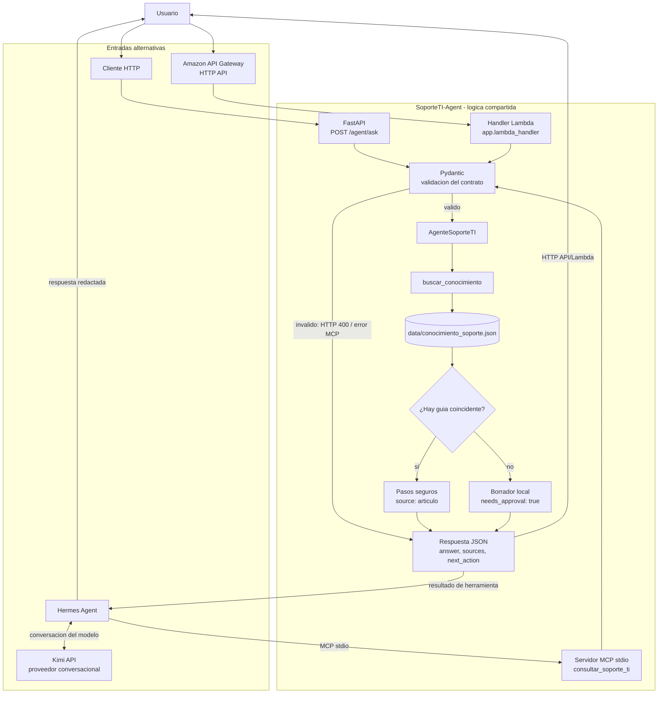

# Arquitectura y Mapa de Componentes

## Componentes y responsabilidades

| Capa | Componente | Responsabilidad | Tecnologia |
| --- | --- | --- | --- |
| Interfaz HTTP | `app/main.py` | Expone `GET /health` y `POST /agent/ask`. | FastAPI |
| Contrato HTTP | `AgentAskRequest`, `AgentAskResponse` | Valida solicitud y estructura de respuesta. | Pydantic |
| Adaptador Lambda | `app/lambda_handler.py` | Adapta eventos de API Gateway HTTP API al mismo contrato y agente. | AWS Lambda |
| Orquestacion compartida | `app/agent.py` (`AgenteSoporteTI`) | Decide entre devolver pasos conocidos o solicitar revision humana. | Python |
| Busqueda y escalacion | `app/tools.py` | Busca el articulo mas especifico por palabra clave completa y prepara un borrador local. | Python |
| Conocimiento | `data/conocimiento_soporte.json` | Contiene articulos, palabras clave y pasos de soporte. | JSON versionado |
| Adaptador MCP | `app/mcp_server.py` (`consultar_soporte_ti`) | Publica la misma logica para Hermes mediante stdio; valida el contrato HTTP. | MCP Python SDK |
| Orquestador conversacional | Hermes Agent | Presenta la conversacion y decide cuando invocar la herramienta MCP. | Hermes |
| Modelo conversacional | Kimi configurado en Hermes | Interpreta la conversacion y redacta la respuesta; no es parte del backend Python. | API Moonshot |
| Configuracion de Hermes | `~/.hermes/config.yaml` y entorno privado de Hermes | Registra el servidor MCP y mantiene la credencial del proveedor fuera del repositorio. | YAML y entorno local |
| Despliegue HTTP | `template.yaml` | Define API Gateway HTTP API y la funcion Lambda de SAM. | AWS SAM |
| Calidad | `tests/test_agent.py` | Verifica contratos, busqueda, escalacion, MCP y API. | Pytest |

## Mapa del flujo de solicitud

La API HTTP, el handler Lambda y el servidor MCP son **tres adaptadores de
entrada** a la logica del mismo `AgenteSoporteTI`; Hermes/Kimi no sustituyen ni
modifican esa logica. La integracion MCP local no requiere iniciar FastAPI ni
desplegar AWS. Kimi solo participa en la conversacion Hermes: la herramienta
MCP devuelve el resultado estructurado del diagnostico.

Para la configuracion reproducible, consulta la
[guia tecnica Hermes + Kimi](guia-tecnica-hermes-kimi.md) y, para el uso
cotidiano, la [guia para usuarios](guia-usuario-hermes-kimi.md).

## Ciclo cloud-native del agente

1. **Objetivo y contexto:** recibe `question`, `user_id` y `context` opcional.
2. **Validacion:** exige pregunta de 5 a 500 caracteres e identificador de usuario de 3 a 50 caracteres.
3. **Decision:** `buscar_conocimiento` compara palabras completas y prefiere la frase coincidente mas especifica.
4. **Respuesta conocida:** devuelve los pasos del articulo, su identificador en `sources`, `needs_approval: false` y `seguir_pasos_seguros`.
5. **Escalacion:** cuando no hay articulo, crea un borrador solo en memoria y devuelve `needs_approval: true` y `borrador_pendiente_aprobacion`.
6. **Observabilidad del resultado:** HTTP expone JSON; MCP entrega los mismos campos como resultado de herramienta.
7. **Limites:** no se ejecutan los comandos que se mencionan en articulos, no se cambia configuracion del equipo, no se modifica una contrasena y no se crea ni envia un ticket real.

## Modos de ejecucion

- **Local conversacional:** Hermes inicia `app.mcp_server` por stdio, utilizando el entorno Python configurado en Hermes. La credencial de Kimi reside en la configuracion privada de Hermes.
- **API HTTP:** FastAPI valida `POST /agent/ask` y responde con el contrato descrito en [api-contract.md](api-contract.md).
- **AWS SAM:** API Gateway HTTP API invoca `app.lambda_handler.handler`, que comparte los modelos Pydantic y el agente.

## Datos, seguridad y limites

- `data/conocimiento_soporte.json` se versiona junto con el codigo; los articulos no se descargan de una fuente externa durante la solicitud.
- El borrador de escalacion no se guarda ni se envia. Un sistema de tickets requerira integracion, persistencia y aprobacion explicita.
- La API HTTP documentada no incluye autenticacion. Antes de exponerla en una red publica se deben anadir autenticacion, autorizacion, limites de uso y transporte seguro.
- MCP stdio es local al entorno que ejecuta Hermes. No se debe exponer como servicio remoto sin autenticacion y transporte seguro.
- Las claves API no pertenecen a la base de conocimiento ni al repositorio. Kimi se configura en Hermes y `.env` se mantiene local.
- El backend determinista no consulta Kimi. La conversacion con el modelo ocurre en Hermes; el backend entrega datos estructurados al modelo mediante MCP.

## Limites y trabajo futuro

La base de conocimiento y los borradores son locales y no persistentes. La
busqueda es por palabras clave, no comprende automaticamente sinonimos,
intencion o multiples incidencias. Para un uso productivo faltan, segun el modo
de despliegue, autenticacion, autorizacion, persistencia/auditoria,
observabilidad, integracion aprobada con tickets y un proceso de revision de
articulos. Las recomendaciones siguen siendo informativas y deben escalarse si
no coinciden con el entorno institucional.