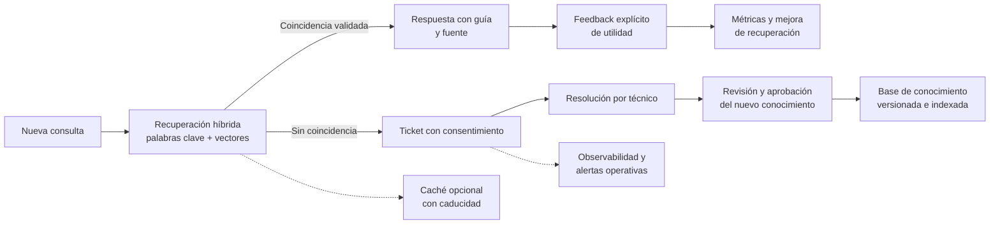

# Fase de mejora propuesta

## De un agente determinista a un soporte asistido por conocimiento

SoporteTI-Agent ya ofrece diagnóstico local basado en guías versionadas,
conversación mediante Hermes, tickets con consentimiento y persistencia SQLite
o Firebase Data Connect si este no tiene conocimiento a la mano hace consultas web desde fuentes confiables. La siguiente fase propone mejorar la recuperación de
conocimiento, aprender de las resoluciones verificadas y reforzar la operación
sin sustituir el control humano ni cambiar silenciosamente el comportamiento
actual.

> **Estado:** propuesta de evolución. Ninguna de las capacidades de esta hoja
> de ruta debe considerarse implementada por el solo hecho de estar descrita
> aquí. La arquitectura vigente y sus límites se mantienen hasta que cada
> cambio se desarrolle, pruebe y documente como funcionalidad disponible.

## Visión de la evolución

El ciclo propuesto conserva una distinción importante: un ticket resuelto es
una fuente potencial de conocimiento, no una guía validada automáticamente.
La nota del técnico y la descripción original pueden ser incompletas,
específicas de una persona o contener datos sensibles. La IA puede ayudar a
preparar un borrador, pero la publicación debe requerir revisión y aprobación
humana.

## Hoja de ruta

Las etapas están ordenadas para establecer primero calidad y controles sobre
los datos antes de añadir servicios externos. Su alcance, proveedores y
criterios de aceptación deberán confirmarse al iniciar cada etapa.

| Etapa | Propuesta | Componentes candidatos | Resultado esperado |
| --- | --- | --- | --- |
| **1. Conocimiento y recuperación** | Combinar la búsqueda léxica existente con embeddings para recuperar guías y casos previos semánticamente similares. Añadir un flujo de revisión de borradores derivados de tickets resueltos y feedback explícito sobre utilidad. | `app/tools.py`, `app/dataconnect_tickets.py`, `data/conocimiento_soporte.json`; posible `app/learning_engine.py`, por definir. | Mejorar la recuperación de sinónimos y convertir resoluciones verificadas en artículos versionados, con trazabilidad y aprobación. |
| **2. Rendimiento y observabilidad** | Evaluar caché de consultas seguras y límites de uso; registrar latencia, errores, consumo y casos sin coincidencia para guiar mejoras. | `app/main.py`, `app/hermes_bridge.py`, `requirements.txt`; Redis/Upstash, Sentry y/o Langfuse, si se aprueban. | Detectar fallos y brechas de conocimiento, y reducir trabajo repetido sin almacenar respuestas obsoletas o información personal innecesaria. |
| **3. Notificaciones resilientes** | Añadir un proveedor de correo de respaldo y alertas operativas configurables para el equipo de soporte. | `app/tickets.py`, `app/dataconnect_tickets.py`; Resend y un canal de alertas, si se aprueban. | Mantener el estado de envío y la auditoría correctos cuando falle el proveedor principal; priorizar avisos según reglas verificables. |
| **4. Evidencias y canal móvil** | Evaluar almacenamiento de evidencias fuera de la base de tickets y un canal alternativo de atención, con webhook protegido. | `app/main.py`, `app/static/index.html`, `dataconnect/schema/schema.gql`; Cloudflare R2 y/o Telegram, si se aprueban. | Facilitar la recepción controlada de evidencias y consultas desde dispositivos móviles, conservando el consentimiento y la protección de datos. |
| **5. Estado del servicio y madurez operativa** | Mostrar interrupciones conocidas y completar el monitoreo de errores y dependencias externas. | `app/main.py`, `app/static/index.html`, `app/static/tickets.html`; Sentry e Instatus, si se aprueban. | Comunicar incidentes generales y ofrecer señales operativas útiles sin confundir el estado de la API con el de sus dependencias. |

### Etapa 1 — Recuperación semántica y ciclo de conocimiento

La búsqueda actual se basa en palabras clave normalizadas. Como siguiente paso
se puede evaluar una recuperación híbrida:

1. Recuperar candidatos por coincidencia léxica y semántica.
2. Comparar resultados con un conjunto de consultas representativas, incluyendo
   paráfrasis, consultas ambiguas y casos sin solución.
3. Medir precisión y cobertura antes de habilitar una respuesta automática;
   cualquier umbral —por ejemplo, una similitud de `0.82`— debe calibrarse con
   esos datos y no tratarse como valor universal.
4. Cuando una consulta no encuentre una guía suficiente, mantener el flujo de
   ticket y resolución humana que ya existe.
5. Si se genera un borrador de guía a partir de una resolución, eliminar o
   anonimizar datos personales y solicitar validación técnica antes de
   publicarlo en la base versionada.
6. Recoger feedback de utilidad de forma explícita. La apertura de un ticket
   por sí sola no demuestra que la guía fuera incorrecta, y una respuesta
   positiva no demuestra que la solución sea segura en otros entornos.

**Opciones a evaluar:** embeddings locales, por ejemplo con `fastembed`, para
mantener el contenido en el equipo; búsqueda coseno en memoria para un índice
pequeño; o un vector store administrado, como Qdrant Cloud, si se justifica
transferir datos y operar una dependencia externa. Costos, límites gratuitos,
retención, rendimiento y condiciones de cada proveedor deben verificarse al
momento de la decisión.

### Etapa 2 — Caché y telemetría

Un Redis administrado puede acelerar operaciones repetidas, y herramientas
como Sentry o Langfuse pueden ayudar a entender errores, latencias y
consultas sin guía. Son alternativas a evaluar, no requisitos ni componentes
configurados actualmente.

- Limitar la caché a resultados adecuados, con expiración, invalidación cuando
  cambie el conocimiento y un comportamiento correcto si el servicio opcional
  no está disponible.
- No guardar por defecto el historial, datos de contacto, imágenes, credenciales
  ni prompts completos. Definir qué campos se registran, quién puede verlos y
  durante cuánto tiempo.
- Evitar que claves basadas solo en la pregunta mezclen respuestas cuando
  cambien el contexto, la versión de las guías o los permisos.
- Configurar límites de uso y respuestas explícitas ante fallos; una caída de
  caché no debe cambiar una respuesta correcta por una respuesta obsoleta.

### Etapa 3 — Correo de respaldo y avisos al equipo

Se puede evaluar Resend como alternativa al envío actual por Gmail API y un
webhook de Discord, Slack u otro canal para avisos de prioridad. El envío
principal y el de respaldo deben distinguir fallos transitorios de errores de
credenciales o configuración, evitar duplicados e informar el estado real en
el ticket.

El mensaje al canal técnico debe contener solo los datos mínimos necesarios.
Los webhooks son credenciales: deben residir fuera del repositorio y no aparecer
en logs. Las prioridades y reglas de escalado deben derivarse del contrato del
ticket y estar cubiertas por pruebas.

### Etapa 4 — Evidencias y canal móvil

Para evidencias, un almacenamiento de objetos compatible con S3 como Cloudflare
R2 podría reducir el crecimiento de SQLite o Cloud SQL. Antes de adoptarlo, hay
que definir consentimiento, retención y eliminación, límites de tamaño,
validación del tipo real del archivo, acceso privado y enlaces firmados con
caducidad. El almacenamiento no debe habilitar cargas públicas ni ampliar los
datos enviados al proveedor del modelo sin informar al usuario.

Telegram puede estudiarse como canal de contingencia. Requeriría validar el
origen de cada webhook, controlar la asociación entre usuario y conversación,
limitar abusos y explicar cómo se procesan y conservan los mensajes. No debe
tratarse como un canal seguro para credenciales o información sensible.

### Etapa 5 — Estado público y monitoreo

Un proveedor de estado como Instatus podría informar interrupciones generales.
La interfaz debería indicar cuándo la información está desactualizada y no
bloquear el acceso al soporte por una consulta fallida al proveedor de estado.
Sentry puede complementar la detección de excepciones si se configura con
filtrado de datos personales, secretos y contenido de conversaciones.

## Principios de diseño y seguridad

- **Revisión humana:** ningún contenido generado a partir de tickets entra
  directamente en producción sin aprobación técnica.
- **Consentimiento y minimización:** compartir una incidencia con un técnico o
  proveedor externo debe limitarse a lo explicado y autorizado por el usuario.
- **Privacidad por defecto:** evitar transmitir preguntas, capturas, historial
  o notas a nuevos servicios sin evaluar la necesidad, la retención y el
  tratamiento de datos.
- **Degradación segura:** las integraciones opcionales no deben ocultar errores,
  afirmar envíos exitosos que no ocurrieron ni invalidar el flujo existente.
- **Trazabilidad:** conservar la procedencia de cada artículo, su aprobación,
  versión y fecha de revisión.
- **Evaluación antes de automatizar:** medir la calidad con casos de prueba
  representativos y revisión de falsos positivos antes de responder por
  similitud semántica.
- **Costos y disponibilidad:** no asumir que una cuota gratuita es permanente
  o suficiente. Confirmar límites, residencia de datos y condiciones vigentes
  antes de adoptar un proveedor.

## Decisiones pendientes antes de iniciar

1. ¿La primera etapa prioriza búsqueda semántica local o se acepta un servicio
   vectorial administrado?
2. ¿Quién revisará y aprobará los borradores de conocimiento y con qué
   procedimiento de publicación y reversión?
3. ¿Qué eventos y campos se pueden observar, y cuál será la política de
   retención y acceso?
4. ¿Qué canales externos están aprobados por la organización para correo,
   alertas, evidencias y mensajería?
5. ¿Qué criterios medibles debe cumplir cada etapa para pasar a producción?

## Criterios de salida sugeridos

Una etapa estará lista para producción cuando tenga pruebas automatizadas,
validación funcional con casos representativos, configuración opcional
documentada, manejo explícito de fallos, revisión de privacidad y seguridad, y
procedimiento para deshabilitar o revertir la integración sin perder tickets.
