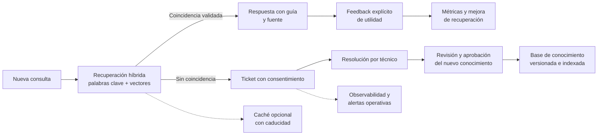

# Fase de mejora: propuesta, logros y pendientes

## De un agente determinista a un soporte asistido por conocimiento

Esta hoja de ruta comenzó como propuesta para mejorar la recuperación de
conocimiento, aprender de resoluciones verificadas y reforzar la operación sin
sustituir el control humano. Las versiones 1.3.9–1.4.0 ya implementaron varias
partes; aquí se separan los logros verificables, lo parcialmente terminado y
los siguientes pasos todavía recomendados.

> **Estado al 11 de noviembre de 2026:** recuperación semántica y feedback
> locales disponibles (etapa 1, parcial); capacidades de las etapas 2–5
> implementadas en 1.4.0. Gmail, Resend, Slack, Firebase (solo lectura) y la
> conexión MTProto pasaron sus comprobaciones descritas abajo; Sentry aceptó
> un evento sintético por HTTP 200 y Hermes devolvió una respuesta en el
> reintento tras un 503 inicial. La verificación no equivale a certificar
> disponibilidad continua ni todos los flujos productivos. Los secretos no se
> incluyen en el repositorio. Consulta el [informe de validación externa](validacion-integraciones-2026-11-11.md).

## Visión de la evolución

El ciclo objetivo conserva una distinción importante: un ticket resuelto es
una fuente potencial de conocimiento, no una guía validada automáticamente.
La nota del técnico y la descripción original pueden ser incompletas,
específicas de una persona o contener datos sensibles. La IA puede ayudar a
preparar un borrador, pero la publicación debe requerir revisión y aprobación
humana.

## Hoja de ruta

El usuario autorizó las integraciones con minimización de datos. Son optativas y
sus credenciales viven fuera del repositorio. La tabla distingue entrega de
funcionalidad de la comprobación en un entorno real:

| Etapa | Alcance que se propuso | Logro y estado actual | Pendiente principal |
| --- | --- | --- | --- |
| **1. Conocimiento y recuperación** | Búsqueda híbrida, benchmark, feedback y borradores de conocimiento revisados por humanos. | Recuperación semántica local opcional (1.3.9), benchmark sintético (1.3.10), feedback mínimo local (1.3.11) y mejoras de paráfrasis (1.3.12–1.3.13). **Parcial.** | Pipeline de borrador, anonimización, aprobación humana, publicación/versionado, reversión y evaluación con consultas representativas anonimizadas. |
| **2. Rendimiento y observabilidad** | Métricas, límites y errores depurados hacia Sentry. | Contadores/latencia en memoria, rate limit por proceso y filtro de datos implementados. Sentry aceptó un evento sintético (HTTP 200). **Implementada y comprobación básica aprobada.** | Observar disponibilidad sostenida y definir alertas/retención; métricas distribuidas si se despliega en varias instancias. No se implementó caché de respuestas ni Redis. |
| **3. Notificaciones resilientes** | Gmail primario, Resend de respaldo y Slack para prioridad alta/crítica. | Estados, clasificación y auditoría implementados. Gmail, Resend y Slack aceptaron mensajes sintéticos reales. **Implementada y comprobación básica aprobada.** | Probar fin a fin el fallo Gmail→Resend y tickets de prioridad alta, reintentos, duplicados y cuotas sin generar tickets de producción. |
| **4. Evidencias y canal móvil** | Retención de capturas y canal Telegram de consulta puntual. | Eliminación al resolver o tras 180 días; canal MTProto personal con allowlist y sesión local. La sesión se conectó y estaba autorizada. **Implementada; Telegram comprobado a nivel de conexión solamente.** | Probar `/start` y `/consulta` desde una cuenta permitida; automatizar limpieza en vez de depender de accesos a tickets; revisar supervisión del proceso MTProto. |
| **5. Estado y madurez operativa** | Página de estado y resumen sin dependencia de status externo. | `/status`, `/api/status`, `/api/metrics` y documentación de límites implementados. Firebase Data Connect respondió a una lectura de tickets (12 elementos en la verificación más reciente) sin cambios. **Implementada; lectura real aprobada.** | Autenticación/autorización para técnicos, monitoreo real de dependencias con timeout y protección antes de cualquier exposición multiusuario. |

El informe [validacion-integraciones-2026-11-11.md](validacion-integraciones-2026-11-11.md)
registra el tipo de prueba, el resultado y sus límites. Una respuesta HTTP 200
de correo/webhook confirma que el proveedor aceptó la solicitud, no la entrega
final al buzón o a todos los miembros del canal.

### Etapa 1 — Recuperación semántica y ciclo de conocimiento

La versión 1.3.9 añade una primera entrega de recuperación semántica local con
FastEmbed, declarado como dependencia opcional en
`requirements-semantic.txt`, y un modelo multilingüe. Se activa con
`SOPORTE_SEMANTIC_SEARCH=true`; por defecto se conserva la búsqueda léxica.
La primera consulta habilitada descarga el modelo al equipo. No se envían las
preguntas ni el contenido de la base a un servicio de embeddings. Mantener
FastEmbed fuera de `requirements.txt` evita ampliar el paquete de AWS Lambda
cuando no se habilita esta función; Lambda conserva la búsqueda léxica.

El umbral inicial de similitud es `0.65` y se considera provisional. Antes de
habilitar la función en producción, debe medirse precisión y cobertura con un
conjunto representativo de consultas reales previamente anonimizadas. El
feedback de utilidad se incorpora en la versión 1.3.11; el flujo de aprobación
de borradores de conocimiento sigue pendiente.

La version 1.3.10 incorpora un benchmark reproducible de consultas sinteticas
en `data/retrieval_evaluation.json`, ejecutable con
`python scripts/evaluate_retrieval.py`. En la primera medicion obtuvo 11/16
aciertos hibridos en primera posicion (69%), 12/16 con el articulo esperado en
los tres primeros (75%) y cero resultados en 3/3 consultas sin guia. En el
grupo de parafrasis, el acierto en primera posicion fue 5/10 (50%); aparecieron
una guia incorrecta para una consulta sobre microfono y una guia de Internet
para una consulta sobre acceso remoto. El conjunto es sintetico y pequeno, por
lo que estos valores sirven como linea base, no como certificacion de calidad.
La busqueda semantica debe permanecer optativa hasta mejorar y validar estos
resultados con casos representativos anonimizados.

La version 1.3.11 permite valorar la guia principal como util o no util. Se
guarda localmente un identificador idempotente del voto, el identificador de
guia, la valoracion y la fecha UTC; no se guardan usuario, pregunta,
conversacion, contacto ni texto libre. El resumen local devuelve conteos por
guia y esta restringido a loopback. Las valoraciones orientan la revision,
pero no publican ni modifican conocimiento automaticamente.

La version 1.3.12 añade frases de recuperacion para parafrasis del problema
"Excel se congela con macro", seis casos sinteticos al benchmark y pruebas
deterministas para esas consultas. Las seis recuperan la guia esperada en
primera posicion tanto con busqueda lexica como hibrida. En el conjunto
ampliado, el resultado hibrido es 17/22 (77%) en primera posicion, 18/22 (82%)
entre los tres primeros y 0/3 falsos positivos en consultas sin guia. El grupo
previo de parafrasis conserva 11/16 (69%), por lo que estos casos no resuelven
las brechas generales observadas. La guia mantiene sus precauciones: no
habilitar macros de fuentes no confiables ni debilitar politicas de seguridad.
El benchmark sintetico no certifica la calidad general de la busqueda semantica.

La version 1.3.13 añade frases de recuperacion para los cinco fallos restantes
del benchmark: una cuenta bloqueada descrita como imposibilidad de entrar,
problemas de microfono durante una videollamada, conectividad de trabajo desde
casa, una impresora que no saca documentos y la imagen ausente en un proyector
de aula. Las pruebas verifican que cada frase apunta a su guia correspondiente.
En la medicion actual, la busqueda lexica acierta 21/22 (95%) en primera
posicion y la hibrida 22/22 (100%); la cobertura hibrida @3 es 22/22, con
0/3 falsos positivos en consultas sin guia. El grupo de parafrasis alcanza
15/16 en busqueda lexica y 16/16 en hibrida. Estos resultados provienen de un
conjunto pequeño y sintetico; la busqueda semantica sigue siendo optativa y
requiere validacion adicional antes de habilitarse en produccion.

La búsqueda existente se basa en palabras clave normalizadas. La recuperación
híbrida sigue esta secuencia:

1. Recuperar candidatos por coincidencia léxica y semántica.
2. Comparar resultados con un conjunto de consultas representativas, incluyendo
   paráfrasis, consultas ambiguas y casos sin solución.
3. Medir precisión y cobertura antes de habilitar una respuesta automática;
   el umbral inicial de `0.65` es provisional y no debe tratarse como valor
   universal.
4. Cuando una consulta no encuentre una guía suficiente, mantener el flujo de
   ticket y resolución humana que ya existe.
5. Si se genera un borrador de guía a partir de una resolución, eliminar o
   anonimizar datos personales y solicitar validación técnica antes de
   publicarlo en la base versionada.
6. Recoger feedback de utilidad de forma explícita. La apertura de un ticket
   por sí sola no demuestra que la guía fuera incorrecta, y una respuesta
   positiva no demuestra que la solución sea segura en otros entornos.

La implementación actual calcula similitud coseno local en memoria para el
conjunto versionado de guías. Un vector store administrado no se adopta en esta
entrega. Si se evalúa posteriormente, habrá que verificar costos, límites,
retención, rendimiento y condiciones del proveedor.

### Etapa 2 — Caché y telemetría

`app/observability.py` agrega por proceso cantidad de solicitudes, códigos HTTP,
errores 5xx y latencia media/máxima usando rutas parametrizadas. No escribe IP,
preguntas, conversaciones, contactos, imágenes ni prompts. `GET /api/metrics`
requiere loopback. `SOPORTE_RATE_LIMIT_PER_MINUTE` limita las rutas de
diagnóstico/chat/ticket/feedback/webhook (60 por minuto por defecto, proceso y
origen de conexión); la limitación es local a cada instancia, no distribuida.

Sentry se activa solo con `SENTRY_DSN` y la dependencia opcional
`requirements-observability.txt`. El filtro permite únicamente metadatos
técnicos mínimos, tipo de excepción y frames sin variables; omite solicitud,
usuario, mensaje, extras y breadcrumbs. La disponibilidad de Sentry no afecta
la respuesta del agente.

No se agregó Redis ni caché de respuestas. La evaluación concluyó que el chat
incluye contexto e historial del usuario y que cachear respuestas puede
mezclarlos o servir resultados obsoletos. La caché actual se limita a la base
de conocimiento/índice local en memoria. Tampoco se informan tokens/costos:
Hermes no proporciona aquí una medición fiable común a todos los proveedores.

### Etapa 3 — Correo de respaldo y avisos al equipo

Gmail se conserva como primario; `RESEND_API_KEY`, `RESEND_FROM` y
`RESEND_TO_EMAIL` habilitan el respaldo cuando Gmail falla o no está configurado.
Las clases `configuration` y `transient` distinguen errores de credenciales/
configuración de errores de transporte/cuota/servidor. El resultado y el
proveedor se persisten en SQLite o metadatos Data Connect, se incluyen en el
panel y se auditan. El ticket se guarda antes de las notificaciones y el
`request_id` previene envíos duplicados por reintentos de creación.

`SLACK_WEBHOOK_URL` solo acepta HTTPS en `hooks.slack.com`. El aviso se limita
a prioridades `high`/`critical` y contiene número de ticket, prioridad y
categoría, sin texto, conversación, contacto ni captura. El estado se guarda
y el backend Data Connect genera evento de auditoría. Los webhooks y API keys
se configuran por entorno y nunca se incluyen en logs o repositorio. La
configuración real de proveedor y su entrega deben probarse en el entorno
operativo antes de producción.

### Etapa 4 — Evidencias y canal móvil

No se incorporó R2: las capturas siguen en el almacenamiento privado de tickets
configurado (SQLite o Data Connect). Se conservan validaciones de MIME/firma y
límite de tamaño; se eliminan al resolver el ticket o al superar 180 días. La
limpieza perezosa se ejecuta al crear/listar/resolver tickets o consultar
adjuntos, y las capturas no se envían a Resend ni Slack. El backend Data Connect
actualiza el metadato de adjuntos al resolver y en consultas posteriores a la
caducidad.

El cliente MTProto opcional `scripts/telegram_mtproto.py` usa una cuenta
personal, requiere `TELEGRAM_MTPROTO_API_ID`, `TELEGRAM_MTPROTO_API_HASH` y
una lista explícita `TELEGRAM_MTPROTO_ALLOWED_USER_IDS`; sin lista no inicia.
Procesa solo mensajes privados `/start` y `/consulta <problema>` de IDs
autorizados, con diagnóstico determinista local y máximo 500 caracteres. No se
invoca Hermes, no se crean tickets y la aplicación no almacena mensajes,
identidad ni historial. La sesión autenticada queda en
`.secrets/telegram-mtproto.session`, excluida de Git y sensible como una
credencial de cuenta. El inicio de sesión inicial es interactivo y debe
realizarse localmente. El endpoint `POST /api/telegram/webhook` permanece como
alternativa legacy independiente para Bot API con token y secreto.

### Etapa 5 — Estado público y monitoreo

`/health` conserva su semántica de liveness de la API. `/status` y
`GET /api/status` muestran el estado general, hora de comprobación y
configuración resumida sin secretos. La página actualiza cada 30 segundos y
advierte si la información supera 60 segundos; si no puede cargar, no bloquea
el acceso al chat. El endpoint no consulta servicios externos ni asegura la
disponibilidad real de Firebase, Hermes, Gmail, Resend, Slack o Telegram:
indica configuración, no un chequeo de conectividad. El estado de la API no
se confunde con esos componentes. No se contrató Instatus; la vista es local
al servicio.

## Principios de diseño y seguridad

- **Revisión humana:** ningún contenido generado a partir de tickets entra
  directamente en producción sin aprobación técnica.
- **Consentimiento y minimización:** compartir una incidencia con un técnico o
  proveedor externo debe limitarse a lo explicado y autorizado por el usuario.
- **Privacidad por defecto:** evitar transmitir preguntas, capturas, historial
  o notas a nuevos servicios sin evaluar la necesidad, la retención y el
  tratamiento de datos.
- **Degradación segura:** las integraciones opcionales no deben ocultar errores,
  afirmar envíos exitosos que no ocurrieron ni invalidar el flujo existente.
- **Trazabilidad:** conservar la procedencia de cada artículo, su aprobación,
  versión y fecha de revisión.
- **Evaluación antes de automatizar:** medir la calidad con casos de prueba
  representativos y revisión de falsos positivos antes de responder por
  similitud semántica.
- **Costos y disponibilidad:** no asumir que una cuota gratuita es permanente
  o suficiente. Confirmar límites, residencia de datos y condiciones vigentes
  antes de adoptar un proveedor.

## Activación y límites pendientes

1. Sentry aceptó un evento sintético (HTTP 200); observar entrega sostenida y
   revisar errores de red en el entorno antes de depender de él como única
   alerta operativa.
2. Cargar secretos de Resend, Slack y Telegram solo en el entorno local o
   gestor de secretos autorizado; proteger especialmente el archivo de sesión
   MTProto y no guardar credenciales en el repositorio.
3. La sesión MTProto se conectó y verificó como autorizada. Queda probar
   `/start` y `/consulta` desde una cuenta permitida sin divulgar códigos,
   teléfonos ni el archivo de sesión.
4. Gmail, Resend y Slack aceptaron mensajes sintéticos de prueba; Firebase se
   leyó sin modificaciones. El informe de validación detalla qué no se probó
   y no certifica la entrega final de correo ni los flujos completos de tickets.
5. Hermes respondió a una consulta sintética en el reintento después de un 503;
   monitorear fallos transitorios y cuota del proveedor.
6. Definir revisión humana y reversión de conocimiento derivado de tickets;
   esta parte de la etapa 1 sigue sin implementarse.

## Mejoras recomendadas para siguientes iteraciones

Las siguientes propuestas no forman parte de lo implementado en 1.4.0. Se
ordenan por riesgo y valor operativo; el orden no implica aprobación ni
compromiso de alcance.

### Prioridad inmediata — seguridad antes de uso multiusuario

- **Autenticación y autorización del panel/API de tickets.** El panel actual
  está limitado a loopback, pero no autentica técnicos. Antes de abrirlo en una
  red o compartirlo, añadir identidad, roles, auditoría de acceso, protección
  CSRF cuando corresponda y pruebas de acceso denegado.
- **Protección y ciclo de vida de secretos.** Rotar cualquier clave o código
  que se haya compartido accidentalmente, usar un gestor de secretos en
  despliegues y definir rotación/revocación para Gmail, Sentry, Resend, Slack,
  Firebase y la sesión MTProto. No registrar valores sensibles.
- **Cerrar la validación de Sentry.** Confirmar respuesta de ingesta con un
  evento controlado, revisar el proyecto/entorno y probar que el evento
  recibido no contiene datos de usuario. Mantener el servicio como no verificado
  hasta entonces.

### Prioridad alta — fiabilidad y operación

- **Prueba integral de notificaciones.** En un entorno de prueba, forzar de
  manera controlada el fallo de Gmail y verificar respaldo Resend, estados,
  auditoría, deduplicación y recuperación sin enviar duplicados a usuarios.
  Probar también alertas Slack `high`/`critical` y el no envío para prioridades
  inferiores.
- **Proceso supervisado para MTProto.** Ejecutarlo con un supervisor/servicio
  que reinicie ante fallos, tenga apagado seguro y compruebe su estado sin
  exponer el archivo de sesión. Añadir prueba real controlada de `/start` y
  `/consulta` solo con una cuenta autorizada.
- **Retención automática fiable.** La eliminación de capturas es perezosa y
  depende de operaciones de tickets/adjuntos. Añadir tarea periódica con
  métricas de elementos eliminados, errores y prueba de recuperación/retención
  para SQLite y Data Connect.
- **Estado operativo real.** Diferenciar liveness de readiness; sondear
  dependencias con timeout y sin exponer detalles internos. Añadir alertas por
  errores, latencias, fallos de correo y antigüedad de datos solo después de
  resolver la entrega de Sentry o elegir otro canal comprobado.
- **Resiliencia distribuida.** Si se ejecutan varias instancias, trasladar
  rate limit, idempotencia/deduplicación y métricas a almacenamiento común.
  Añadir colas/reintentos limitados y una vía de inspección de notificaciones
  fallidas sin guardar contenido innecesario.

### Prioridad media — calidad del conocimiento y datos

- **Ciclo editorial de conocimiento.** Crear borrador a partir de resolución,
  quitar datos personales, guardar fuente/autor/fecha, requerir aprobación
  técnica, publicar con versión y permitir reversión.
- **Evaluación de recuperación.** Ampliar el conjunto sintético con casos
  anonimizados representativos, medir precisión@1/@3 y falsos positivos por
  categoría, revisar cada cambio de umbral y conservar una línea base.
- **Gestión de tickets y privacidad.** Definir retención para tickets,
  conversaciones y datos de contacto (no solo capturas), borrado/exportación
  según política institucional y límites de acceso por rol.
- **Backups y recuperación.** Documentar cifrado, periodicidad, restauración
  probada y responsabilidades para SQLite y Firebase/Cloud SQL.

### Oportunidades futuras — evaluar antes de adoptar

- Caché solo para contenido inmutable/versionado y sin mezclar historial,
  identidad, permisos ni contexto de consultas.
- Panel operativo con métricas agregadas y tendencias, sin preguntas ni datos
  personales; exportación distribuida solo si el despliegue lo necesita.
- Almacenamiento de objetos privado para evidencias si el tamaño/volumen lo
  justifica, con enlaces de duración limitada, control de acceso y borrado
  verificable.
- Integración con mesa de servicio institucional o canal adicional solo tras
  definir consentimiento, minimización, idempotencia y plan de salida.

## Criterios de salida sugeridos

Una etapa estará lista para producción cuando tenga pruebas automatizadas,
validación funcional con casos representativos, configuración opcional
documentada, manejo explícito de fallos, revisión de privacidad y seguridad, y
procedimiento para deshabilitar o revertir la integración sin perder tickets.
Las integraciones externas deben contar además con una comprobación de
aceptación y límites documentados; una variable configurada no equivale a
entrega verificada.
